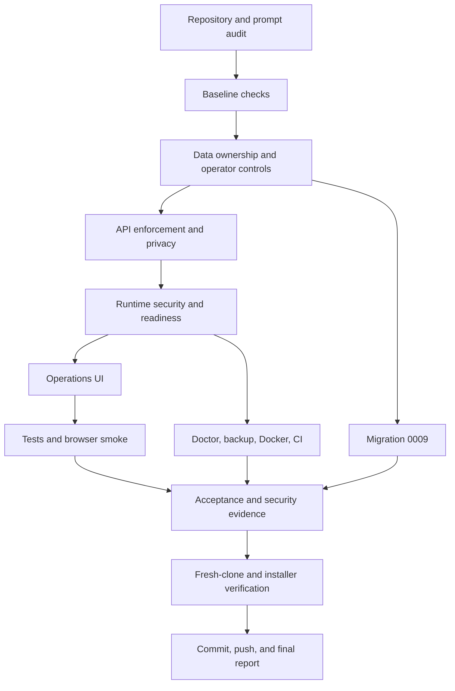

# Task Graph

Critical dependencies:

- Privacy deletion depends on complete ownership/cascade mapping.
- Emergency stop depends on persistence plus enforcement in API and scheduler paths.
- Browser acceptance depends on build, local production startup, and desktop auto-login isolation.
- Hosted readiness depends on startup configuration and a database query.
- Release completion depends on deterministic tests, build, doctor, no-secret search, migration review, and manual browser evidence.
